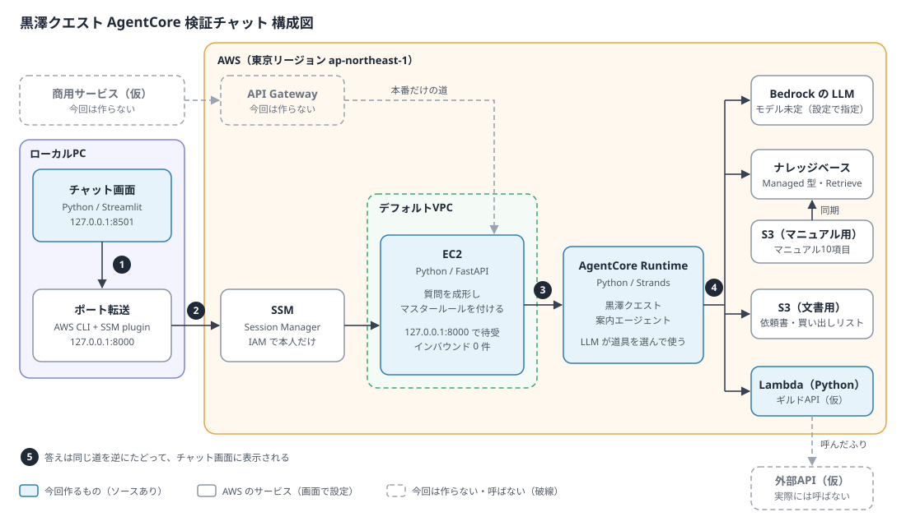

# agentcore-chat-lab（黒澤クエスト AgentCore 検証チャット）

ローカルPCのチャット画面 → SSM（ポート転送）→ EC2（質問の成形・マスタールール）→ Amazon Bedrock AgentCore Runtime → Bedrock の LLM / ナレッジベース / S3 / Lambda、という流れを、個人の AWS アカウント（東京リージョン）で試すための手順書とソース一式です。題材は架空のゲーム「黒澤クエスト」です。



## まず読むもの
- 手順書（Web で読む）: https://kabamodoki.github.io/kurosawaAgent/ （GitHub Pages。`docs/` フォルダを公開）
- 手順書（読みやすい版）: [docs/setup-guide.html](docs/setup-guide.html) をブラウザで開く（左に目次、コードのコピーボタン、手順ごとの「済」チェック）
- 手順書（元の版）: [docs/setup-guide.md](docs/setup-guide.md)。直すときはこちらを直し、`docs` フォルダで `python build_guide_html.py` を実行して HTML を作り直す（初回だけ `python -m pip install markdown==3.10.3 pymdown-extensions==12.3`）

## フォルダ

| フォルダ | 中身 | どこで動くか |
|---------|------|-------------|
| `local_chat/` | チャット画面（Streamlit）、ポート転送とチャット画面の起動用バッチ | 自分のPC |
| `ec2_app/` | 受付API（FastAPI）、マスタールール、常駐の設定 | EC2 |
| `agent/` | エージェント（Strands Agents）、設定ファイル、zip を作るスクリプト | AgentCore Runtime |
| `lambda/` | 冒険者ギルドAPI（仮） | Lambda |
| `data/manual/` | 黒澤クエストのマニュアル10項目 | S3（マニュアル用）→ ナレッジベース |
| `data/documents/` | 依頼書・買い出しリスト・テスト用の文書 | S3（文書用）の `documents/` |
| `iam/` | 貼り付けて使う IAM ポリシー | IAM |
| `tests/` | AWS を使わないテスト | 自分のPC |
| `docs/` | 手順書・構成図 | — |

## テストの動かし方（AWS は使いません）

```
python -m venv .venv
.venv\Scripts\python -m pip install -r local_chat/requirements.txt -r ec2_app/requirements.txt -r agent/requirements.txt pytest httpx
.venv\Scripts\python -m pytest tests
```

## 大事な決めごと
- LLM のモデルは決め打ちしていません。`agent/config.json` の `MODEL_ID` に書きます
- EC2 のセキュリティグループのインバウンドは0件です。入る方法は SSM だけです
- Lambda は外部APIを呼んだふりだけをします（`.example` の予約ドメインを使い、通信はしません）
- 料金の金額は書いていません。検証が終わったら手順書の13章で片付けてください
